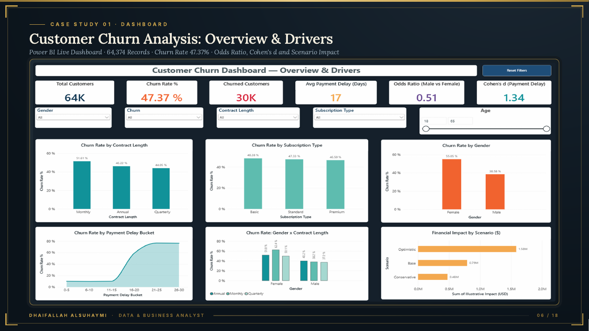

# 1. Customer Churn Analysis & Retention Strategy

**Tools:** Excel, Power Query, Power BI, DAX | **Data:** 64,374 customer records (public Kaggle practice dataset)

**Data source:** [Customer Churn Dataset (Kaggle, muhammadshahidazeem)](https://www.kaggle.com/datasets/muhammadshahidazeem/customer-churn-dataset), file `customer_churn_dataset-testing-master.csv` (64,374 rows).

## Question
What drives customers to leave, and what is the revenue at stake?

## Approach
Cleaned 64,374 records in Power Query and built 6 DAX measures for churn rate, spend and segment comparisons.

## Findings
- Overall churn is **47.37%**.
- **Payment delay** is the strongest signal: 71% churn beyond 15 days vs about 10% before (Cohen's d = 1.34).
- Churned customers represent **$15.8M** of spend.

## Decision
Send a payment alert at day 10. An illustrative 5% save would retain about **$792K** (range $475K to $1.58M).

## Limitations
The dataset is a practice dataset and looks statistically too clean; results demonstrate the method, not market findings. Dollar figures are scenario estimates.
