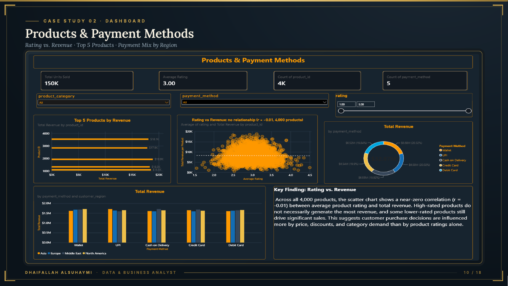

# 2. E-Commerce Revenue Analysis

**Tools:** Excel, Power Query, Power BI, DAX | **Data:** 50,000 orders, 2022-2023 (public Kaggle practice dataset)

**Data source:** [Amazon Sales Dataset (Kaggle, aliiihussain)](https://www.kaggle.com/datasets/aliiihussain/amazon-sales-dataset) (50,000 orders).

## Question
Do discounts increase sales enough to justify their cost?

## Approach
Built 12 DAX measures over $32.87M in revenue, across 6 categories, 4 regions and 5 payment methods.

## Findings
- Discounts **did not lift units per order** (about 3.0 at every discount level), while **$5.05M (15.4% of revenue)** was given up.
- No seasonality (2023 growth +0.54%).
- No link between product rating and revenue (r = -0.01 across 4,000 products).

## Decision
Re-price the 30%-off tier to 20%, recovering about **$621K** at the same units.

## Limitations
The source data looks synthetic (flat patterns), so this is a method demonstration. The recommendation should be tested as a pilot before being treated as a result. Dollar figures are scenario estimates.
