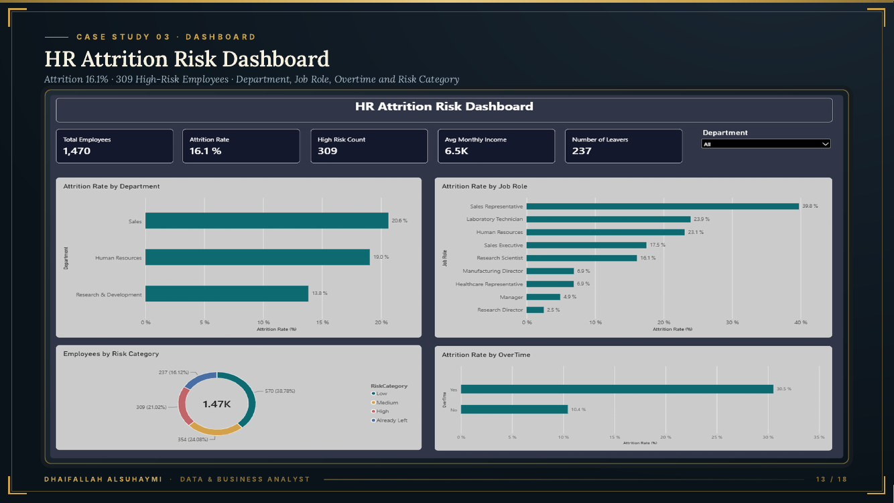

# 3. HR Attrition Risk Analytics

**Tools:** Excel, Power Query, Power BI, DAX | **Data:** 1,470 employees (public Kaggle practice dataset)

## Question
Who is leaving, and which current employees are most at risk?

## Findings
- Attrition is **16.1%** (237 leavers).
- **Overtime** workers leave at 30.5% vs 10.4% (about 3x).
- **Sales Representatives** leave at 39.8% (33 of 83).
- **309** current employees are rated High risk in the dataset's own risk field; the dashboard segments them by department and role.

## Decision
Limit overtime and put retention plans in place for the 309 high-risk employees. Estimated exit cost is about **$6.8M** (assumption-based: 50% of leavers' average annual pay of $57,445; USD assumed because the data has no currency).

## Limitations
The risk rating comes from a column in the dataset, not from a model built here. The dollar estimate depends on the stated assumptions.
