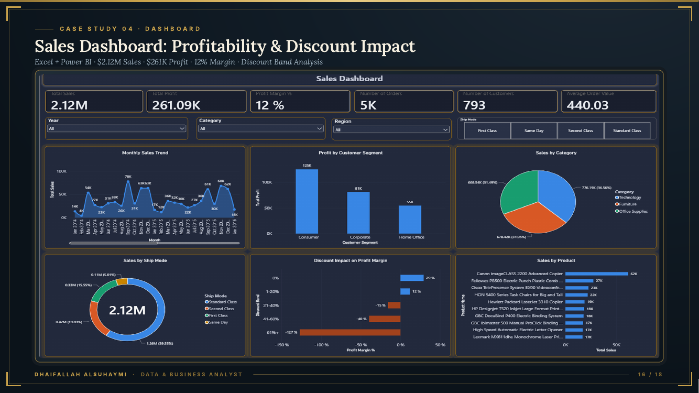

# 4. Sales Dashboard Rebuild: Profitability & Discounts

**Tools:** Excel, Power Query, Power BI, DAX | **Data:** 9,223 order lines, 2014-2017 (public Kaggle practice dataset)

**Data source:** [Superstore Dataset (Kaggle, vivek468)](https://www.kaggle.com/datasets/vivek468/superstore-dataset-final). This analysis uses 9,223 rows (2014-2017).

## Question
Why did an existing executive dashboard mislead, and where is profit lost?

## Approach
Rebuilt an unreliable dashboard: fixed an unlinked calendar table, sort order, a duplicate filter and the margin format.

## Findings
- A **5.6x** seasonal gap between November and February sales.
- Margin falls from **29%** with no discount to **-127%** at 61%+ discount (overall margin 12.3% on $2.12M sales).

## Decision
Cap discounts to protect margin.

## Limitations
Practice dataset; results demonstrate the method, not market findings.
